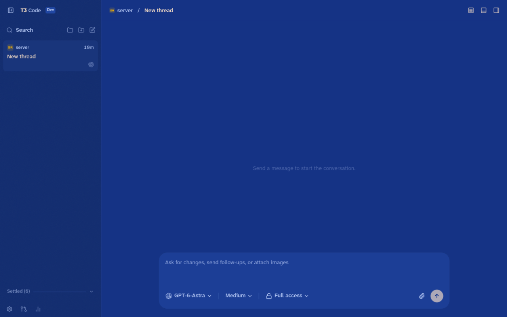
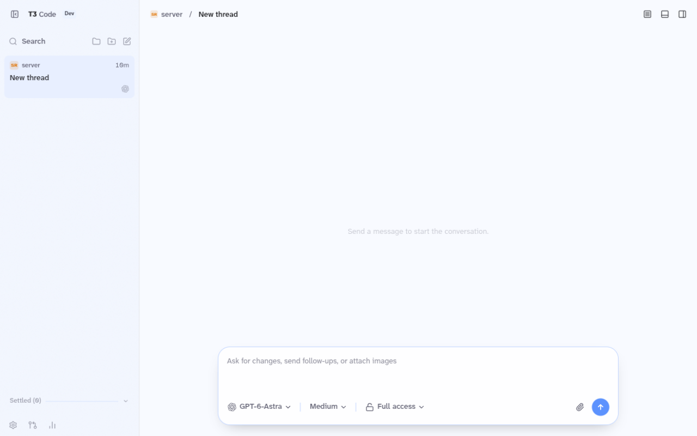
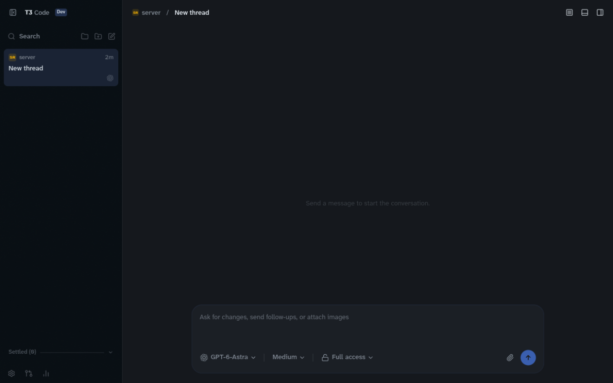
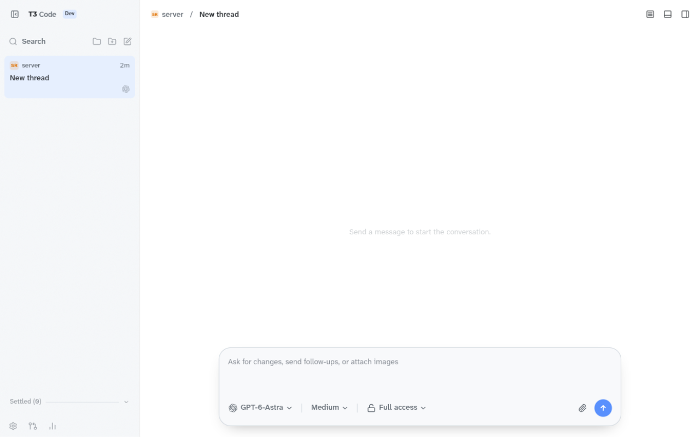

# T3 Code themes

[](LICENSE)

Importable color themes for [T3 Code](https://github.com/pingdotgg/t3code), built with T3's own palette engine so every file is something the app's importer accepts as-is. The first two come from the desktop skins in [Hermes Agent](https://github.com/NousResearch/hermes-agent) by Nous Research.

Each theme ships a **light and a dark** variant and sets all 57 of T3's color roles, so nothing falls back to another palette.

|  | Dark | Light |
| --- | --- | --- |
| **Nous Alt** |  |  |
| **Nous** |  |  |

## Themes

| Theme | File | Source | Look |
| --- | --- | --- | --- |
| **Nous Alt** | [`themes/nous-alt.json`](themes/nous-alt.json) | Hermes Desktop `nous-alt` | Dark: cream on mission-blue (`#0d2f86` canvas, `#09286f` sidebar, `#ffe6cb` text and primary). Light: glass neutrals with brand blue `#0053fd`. |
| **Nous** | [`themes/nous.json`](themes/nous.json) | Hermes Desktop `nous` | GitHub Light/Dark Default chrome with a Nous-blue accent (`#0053fd` light, `#4a84fe` dark). Near-black in dark mode. |

## Install

### Import into the app (per device)

1. Download the theme file from [`themes/`](themes/) (or from the [latest release](../../releases/latest)).
2. In T3 Code open **Settings → Appearance → Add theme**.
3. Drop the `.json` file in, or paste its contents into **Theme JSON**, then click **Add theme**. The theme is selected automatically.

Imported themes are saved in that browser or desktop profile, so import once per device. With **System** selected under *Color scheme* the theme follows your OS between its light and dark variants. To use a different theme for each mode, pick the matching preview on the theme's card.

### Publish from a server

T3 can also follow themes published by the server it connects to. Copy a file into the server's `themes` directory; the **file name is the theme id**:

```bash
cp themes/nous-alt.json ~/.t3/userdata/themes/
t3 theme set nous-alt   # optional: make it the default for connected clients
```

Web and desktop clients connected to that server pick it up live. See T3's [appearance docs](https://github.com/pingdotgg/t3code/blob/main/docs/user/appearance.md#environment-themes) for the details.

## What to expect

- Custom themes don't get the built-in themes' sidebar banner artwork; they use the plain fallback.
- Success, info and provider/channel colors aren't themeable in T3, so they stay as the app ships them.
- The mobile app has its own themes and ignores these.
- Colors are stored as OKLCH, which is what T3 uses internally.

## How they're made

`build.ts` defines each theme as a small spec and does the same four things for every one:

1. **Seed** a full 57-role palette with T3's `createVividThemeColors`, which contrast-solves every foreground against its surface.
2. **Overlay** the exact colors from the source palette. Where a skin uses a transparent color (Nous Alt's light borders), it is flattened over the surface it sits on, the way T3's own stock palettes are.
3. **Re-derive paired roles** (an action color and its hover, status colors and their surfaces) through the same family logic the in-app editor uses.
4. **Validate** by writing the file with T3's serializer, reading it back with T3's importer parser, and checking 19 text/background pairs per appearance against WCAG (7:1 for body text on the canvas, 4.5:1 for the rest).

T3's `themePalette.ts`, `themePalettes.ts` and `vscodeThemeImport.ts` are vendored unmodified in [`vendor/`](vendor/PROVENANCE.md), so the generator runs the same code the app ships.

### Fidelity notes

- Source palette values are used as published, not adjusted by eye. Hermes Desktop appears to render its canvas a little darker than its own tokens (sampled screenshots come out darker, and its home screen has a paint texture), so Nous Alt can look slightly lighter here than in Hermes. The tokens are what's in the file.
- One deliberate deviation: in dark **Nous**, `mutedForeground` is `#808993` instead of Hermes's `#7d8590`, because Hermes's pair on its muted surface is 4.49:1, just under WCAG AA. It is now 4.71:1. Other muted roles keep Hermes's value.
- Roles the source skins don't define (toolbar controls, scrollbars, warning, sidebar control surface, and so on) are derived from the seed colors.

### Build from source

Requires [Bun](https://bun.sh).

```bash
bun install --frozen-lockfile
bun run build                # rebuilds every theme into themes/
bun run build.ts nous-alt    # or just one
```

To add a theme, add a `ThemeSpec` to the `THEMES` list in `build.ts`: a light and a dark spec, each with seed colors, role overrides and a few paired-role families. The build exits non-zero if a file fails to round-trip or a text pair drops under its contrast floor.

> The in-app importer is stricter than the server folder. It needs the full export format (`"version": 1`, a non-empty `colors` object, only known role names). The short `canvas` + `accent` form T3 documents is for the server `themes/` folder only, and these files use the full format so they work in both places.

## Status

Built and checked against **T3 Code v0.0.45** (`main` at `31a9da1`).

Checked:
- Both themes import through the real **Add theme** dialog in a T3 Code dev build (web client), and both light and dark variants render. The screenshots above are from that build, showing an empty thread.
- Both files decode against T3's server-side theme schema (valid id, colors present, 6 KB of the 32 KB limit).
- All text/background pairs pass the contrast checks above.

Not checked: the Electron desktop app, `t3 theme set` against a live server, the mobile app, and real conversation content (messages, code blocks, diffs, the terminal). If a role looks off somewhere, open an issue.

If T3 adds new color roles later, an older theme file fills the missing ones from T3 Chat's pink palette. Re-vendor the files in `vendor/` and rebuild to pick them up.

## Credits and license

[MIT](LICENSE). Third-party notices are in [THIRD_PARTY_NOTICES.md](THIRD_PARTY_NOTICES.md).

- Palettes derive from the desktop skins in [Hermes Agent](https://github.com/NousResearch/hermes-agent) (MIT, © Nous Research).
- The generator vendors and runs code from [T3 Code](https://github.com/pingdotgg/t3code) (MIT, © T3 Tools Inc.).

This is an independent project. It is not affiliated with, endorsed by, or sponsored by T3 Tools or Nous Research. "T3 Code", "Nous" and "Hermes Agent" are the names of their respective owners' products.
